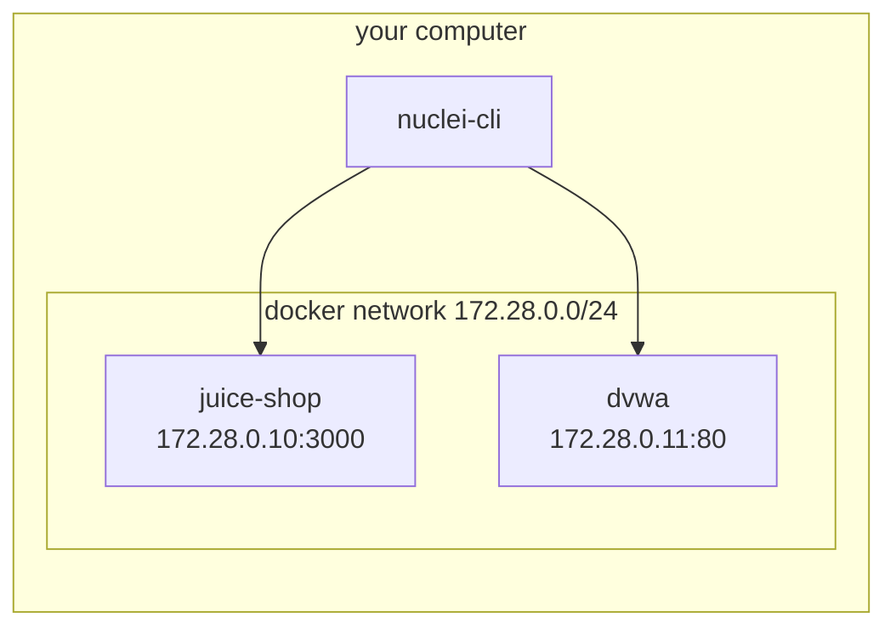

# Where to try it safely

🌐 [Italiano](../07-lab.md) · **English** · [中文](../zh/07-lab.md)

To learn, you need something of your own to scan.

With the Docker lab (`lab/`): `nuclei-cli lancia critici http://172.28.0.11 --scope examples/scope.lab.toml`. Both applications are deliberately vulnerable, so nuclei will find something: a chance to try `rapporto` and `confronta` on real results.

## The Docker lab

`lab/` contains a `docker-compose.yml` that starts two deliberately vulnerable targets on an isolated network.



The two applications are OWASP Juice Shop and DVWA, public projects built to be attacked. Never expose them on a real network.

```sh
cd lab && docker compose up -d
```

The lab scope is in `examples/scope.lab.toml`. Update the dates: the example ones expire.

## Exercises

1. Run the same profile with one target in scope and one out of scope. Which code do you get, and why does not even the first one start?
2. Add a host to `esclude` and run again. What changes?
3. Change `valido_fino` to a past date.
4. Open `nuclei-cli.audit.jsonl`, change one letter by hand in a line in the middle, and run `nuclei-cli audit`.
5. Try passing a forbidden flag after `--` and read the message.
6. Do two runs and compare them with `nuclei-cli confronta`.

## Cleanup

```sh
docker compose down
```

## Note

The compose file has not been tested on every Docker version. If the command fails, check that the images still exist on the registry and that the `172.28.0.0/24` network does not clash with one already in use.
